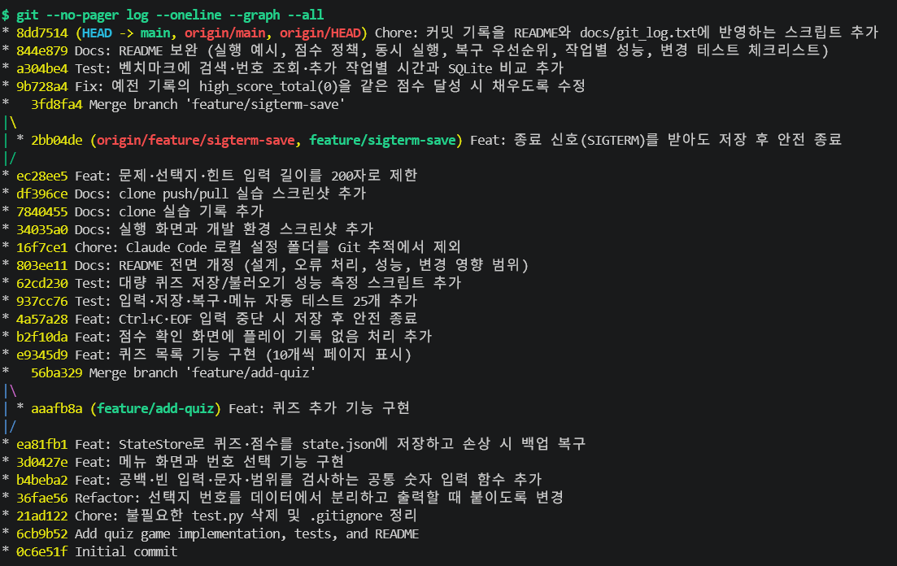
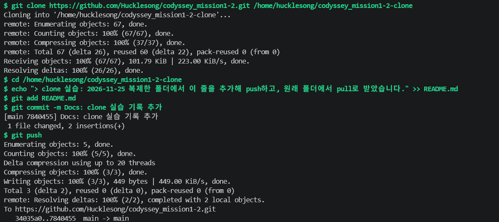
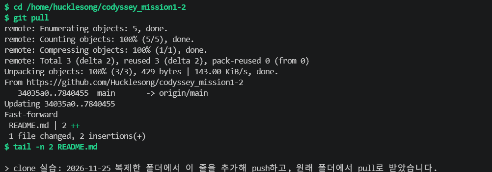
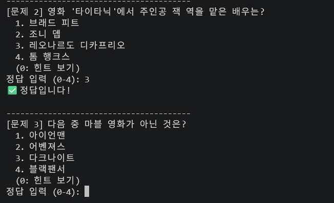
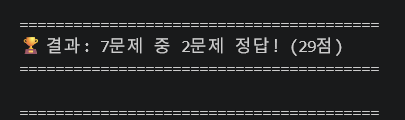
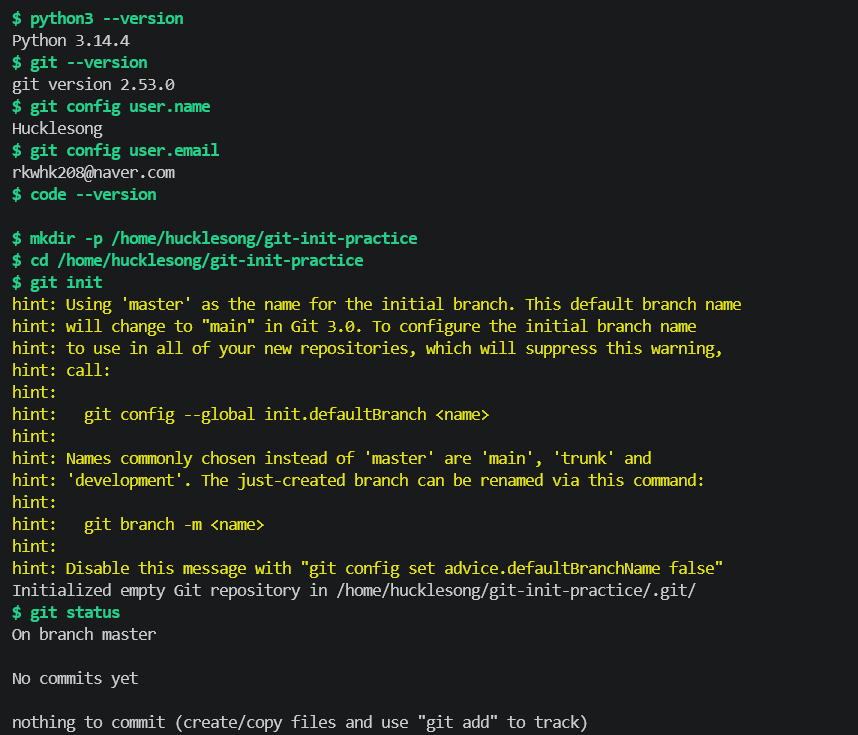

# 🎬 영화 퀴즈 게임 (codyssey_mission1-2)

터미널에서 실행하는 영화 상식 퀴즈 게임입니다.
Python 기본 문법과 클래스 3개로 기능을 나눴고, 퀴즈와 점수를 `state.json`에 저장해 프로그램을 다시 실행해도 데이터가 유지됩니다.
파일이 없거나 손상되어도 백업에서 복구하거나 기본 퀴즈로 실행되며, 개발 과정은 Git으로 기능 단위 커밋과 브랜치 병합을 하며 기록했습니다.

## 목차

1. [프로젝트 개요](#1-프로젝트-개요)
2. [퀴즈 주제 선정 이유](#2-퀴즈-주제-선정-이유)
3. [실행 방법](#3-실행-방법)
4. [기능 목록](#4-기능-목록)
5. [파일 구조](#5-파일-구조)
6. [설계: 클래스와 역할](#6-설계-클래스와-역할)
7. [데이터 파일 설명 (state.json)](#7-데이터-파일-설명-statejson)
8. [오류 처리와 백업·복구](#8-오류-처리와-백업복구)
9. [대량 데이터 분석 (1,000개 이상)](#9-대량-데이터-분석-1000개-이상)
10. [요구사항 변경 시 영향 범위](#10-요구사항-변경-시-영향-범위)
11. [테스트](#11-테스트)
12. [Git 작업 기록과 커밋 규칙](#12-git-작업-기록과-커밋-규칙)
13. [실행 화면](#13-실행-화면)

---

## 1. 프로젝트 개요

| 항목 | 내용 |
| --- | --- |
| 미션 | 올인원 1기 입학 연수 – 컴퓨터에게 명령 내리는 말(파이썬) 처음 배우기 |
| 프로그램 | 터미널(콘솔) 기반 퀴즈 게임 |
| 퀴즈 주제 | 영화 (한국 영화, 할리우드, 마블/DC, 아카데미) |
| 개발 언어 | Python 3.10 이상, 표준 라이브러리만 사용 (`json`, `os`, `shutil`) |
| 개발 환경 | Windows + WSL2 (Ubuntu), VS Code |
| 데이터 저장 | 프로젝트 루트의 `state.json` (UTF-8) |

이 프로젝트로 익힌 내용

- 변수, 자료형(int/str/bool/list/dict), 조건문, 반복문, 함수(매개변수와 반환값)
- 클래스와 객체: `Quiz`, `StateStore`, `QuizGame`으로 역할 분리
- 파일 입출력과 JSON을 이용한 데이터 영속성, `try/except` 예외 처리
- Git 기본 명령어 7종(`init`, `add`, `commit`, `push`, `pull`, `checkout`, `clone`)과 브랜치 병합

---

## 2. 퀴즈 주제 선정 이유

영화는 누구나 한 번쯤 본 작품이 있어 문제를 풀 때 부담이 적고, 감독·배우·명대사처럼 정답이 분명한 문제를 만들기 좋습니다.
평소 영화를 즐겨 보기 때문에 문제를 직접 만들고 힌트를 쓰는 과정 자체가 재미있을 것이라 생각해 주제로 선택했습니다.
'기생충'의 아카데미 수상처럼 한국 영화와 해외 영화를 함께 다뤄 난이도가 다양한 문제를 구성했습니다.

### 기본 퀴즈 구성 (7문제)

| # | 문제 | 분류 | 난이도 |
| --- | --- | --- | --- |
| 1 | '기생충'의 감독 | 한국 영화 · 감독 | 쉬움 |
| 2 | '타이타닉' 잭 역 배우 | 할리우드 · 배우 | 쉬움 |
| 3 | 마블 영화가 아닌 것 | 마블/DC | 보통 |
| 4 | '인터스텔라'의 감독 | 할리우드 · 감독 | 보통 |
| 5 | '기생충'의 아카데미 최고 영예 | 시상식 | 어려움 |
| 6 | '해리포터' 해리 역 배우 | 할리우드 · 배우 | 쉬움 |
| 7 | '엔드게임'에서 희생한 캐릭터 | 마블/DC | 보통 |

모든 문제에 힌트가 있으며, 기본 퀴즈는 `questions.py`에 들어 있습니다.

---

## 3. 실행 방법

### 요구 사항

- Python 3.10 이상
- 외부 라이브러리 설치 필요 없음

### 실행

```bash
# 1. 저장소 복제
git clone https://github.com/Hucklesong/codyssey_mission1-2.git
cd codyssey_mission1-2

# 2. 게임 실행 (WSL/Ubuntu, macOS)
python3 main.py

# Windows PowerShell에서는
python main.py
```

### 종료

- 메뉴에서 `5. 종료`를 선택하면 저장 후 종료합니다.
- 실행 중 `Ctrl+C`를 누르거나 입력이 끊겨도(EOF, `Ctrl+D`) 저장한 뒤 안전하게 종료합니다.

### 테스트와 성능 측정

```bash
python3 -m unittest discover -s tests -v   # 자동 테스트 29개
python3 tools/benchmark.py                 # 퀴즈 1천/1만/10만 개 저장·불러오기·검색·추가 측정
python3 tools/update_git_log.py            # 커밋 기록을 README와 docs/git_log.txt에 반영
```

---

## 4. 기능 목록

### 메뉴

```
========================================
1. 퀴즈 풀기
2. 퀴즈 추가
3. 퀴즈 목록
4. 점수 확인
5. 종료
========================================
선택:
```

### 기능 설명

| 메뉴 | 기능 | 동작 | 담당 메서드 |
| --- | --- | --- | --- |
| 1 | 퀴즈 풀기 | 저장된 퀴즈를 차례로 출제하고 정답/오답을 바로 알려줍니다. 모두 풀면 결과(정답 수, 100점 환산)를 보여주고 최고 점수와 비교해 갱신합니다. | `play()`, `ask()`, `finish_game()` |
| 1 | 힌트 보기 | 풀이 중 `0`을 입력하면 그 문제의 힌트를 봅니다. 힌트가 없는 문제는 0을 받지 않습니다. | `ask()`, `Quiz.show_hint()` |
| 2 | 퀴즈 추가 | 문제, 선택지 4개, 정답 번호(1~4), 힌트(선택)를 입력받아 등록하고 바로 파일에 저장합니다. | `add_quiz()` |
| 3 | 퀴즈 목록 | 등록된 문제를 번호와 함께 10개씩 보여줍니다. Enter로 다음, `q`로 그만 봅니다. | `list_quizzes()` |
| 4 | 점수 확인 | 최고 점수와 총 플레이 횟수를 보여줍니다. 아직 풀지 않았으면 안내합니다. | `show_score()` |
| 5 | 종료 | 데이터를 저장하고 종료합니다. | `run()`, `save()` |

### 입력 처리 기준

숫자 입력은 모두 `QuizGame.get_number()` 한 곳에서, 글자 입력은 `get_text()`에서 처리합니다.

| 입력 | 처리 | 안내 메시지 예 |
| --- | --- | --- |
| 앞뒤 공백 (` 1 `) | `strip()`으로 제거 후 처리 | — |
| 빈 입력 (Enter) | 다시 입력 | `⚠️ 입력이 비어 있습니다. 1-5 사이의 숫자를 입력하세요.` |
| 숫자가 아님 (`abc`) | 다시 입력 | `⚠️ 숫자가 아닙니다. 1-5 사이의 숫자를 입력하세요.` |
| 범위 밖 (메뉴 `9`, 정답 `7`) | 다시 입력 | `⚠️ 범위를 벗어났습니다. 1-5 사이의 숫자를 입력하세요.` |
| 빈 문제/선택지 | 다시 입력 | `⚠️ 내용을 입력하세요.` |
| 매우 긴 글 (200자 초과) | 다시 입력 (`MAX_TEXT_LENGTH`) | `⚠️ 너무 깁니다. 200자 이내로 입력하세요. (지금 350자)` |
| 매우 큰 숫자 (`99999…`) | 범위 밖 또는 숫자 아님으로 처리 (4,300자리 이상은 파이썬이 변환을 거부) | `⚠️ 범위를 벗어났습니다. …` |
| 음수 (`-1`) | 범위 밖으로 처리 | `⚠️ 범위를 벗어났습니다. …` |
| `Ctrl+C`, EOF | 저장 후 종료 | `⚠️ 입력이 중단되어 프로그램을 종료합니다.` |
| 종료 신호 (`kill`, SIGTERM) | 저장 후 종료 | `⚠️ 종료 신호(SIGTERM)를 받았습니다.` |
| 퀴즈가 0개 | 풀기/목록에서 안내 | `📭 등록된 퀴즈가 없습니다.` |

### 실행 예시 (실제 세션 로그)

처음 실행해 잘못된 입력 → 퀴즈 풀기(힌트 사용) → 점수 확인 → 종료까지의 실제 출력입니다. (`…`은 중간 문제 생략)

```
========================================
       🎬 영화 퀴즈 게임 🎬
========================================
📂 기본 퀴즈 7개로 시작합니다.

========================================
1. 퀴즈 풀기
2. 퀴즈 추가
3. 퀴즈 목록
4. 점수 확인
5. 종료
========================================
선택: abc
⚠️ 숫자가 아닙니다. 1-5 사이의 숫자를 입력하세요.
선택: 1

📝 퀴즈를 시작합니다! (총 7문제)

----------------------------------------
[문제 1] 영화 '기생충'의 감독은 누구인가요?
  1. 박찬욱
  2. 봉준호
  3. 최동훈
  4. 류승완
  (0: 힌트 보기)
정답 입력 (0-4): 0
💡 힌트: 설국열차, 괴물을 만든 감독이에요.
정답 입력 (0-4): 2
✅ 정답입니다!
…
----------------------------------------
[문제 4] 영화 '인터스텔라'의 감독은?
  1. 스티븐 스필버그
  2. 제임스 카메론
  3. 크리스토퍼 놀란
  4. 리들리 스콧
  (0: 힌트 보기)
정답 입력 (0-4): 1
❌ 오답입니다. 정답은 3번 (크리스토퍼 놀란)입니다.
…
========================================
🏆 결과: 7문제 중 6문제 정답! (86점)
🎉 새로운 최고 점수입니다!
========================================
…
선택: 4
🏆 최고 점수: 86점 (7문제 중 6문제 정답)
🎮 총 플레이 횟수: 1회
…
선택: 5
👋 게임을 종료합니다. 다음에 또 만나요!
```

---

## 5. 파일 구조

```
codyssey_mission1-2/
├── main.py                 # 프로그램 시작점. Quiz / StateStore / QuizGame 클래스
├── questions.py            # 기본 퀴즈 데이터 (영화 퀴즈 7문제)
├── state.json              # 퀴즈·점수 저장 파일 (실행하며 갱신)
├── tests/
│   └── test_quiz_game.py   # 자동 테스트 29개 (unittest)
├── tools/
│   ├── benchmark.py        # 대량 퀴즈 저장·불러오기·검색·추가 성능 측정
│   └── update_git_log.py   # 커밋 기록을 README·docs/git_log.txt에 반영
├── docs/
│   ├── git_log.txt         # 전체 커밋 기록 텍스트 (git log --oneline --graph --all)
│   └── screenshots/        # 실행 화면, 개발 환경, git log, clone/pull 캡처
├── README.md
└── .gitignore              # 캐시, 백업(.bak), 임시(.tmp), 손상 보관(.corrupted) 파일 제외
```

실행 중 자동으로 생기는 파일 (Git에는 올리지 않음)

| 파일 | 생기는 때 | 용도 |
| --- | --- | --- |
| `state.json.bak` | 두 번째 저장부터 매번 | 직전 정상본 백업 |
| `state.json.tmp` | 저장하는 순간 잠깐 | 안전한 저장을 위한 임시 파일 (저장 후 사라짐) |
| `state.json.corrupted` | 손상된 파일을 발견했을 때 | 손상 원본 보관 (직접 확인·복구용) |

---

## 6. 설계: 클래스와 역할

### 클래스를 쓴 이유

퀴즈 하나는 문제·선택지·정답·힌트 네 값이 항상 함께 다닙니다. 이것을 리스트 네 개로 따로 관리하면 하나를 지울 때 나머지도 똑같이 고쳐야 하고, 하나라도 빠뜨리면 데이터가 어긋납니다.
클래스로 묶으면 "관련된 데이터 + 그 데이터를 다루는 기능"이 한 곳에 모이고, 각 클래스가 맡은 일만 하므로 고칠 곳을 찾기 쉬워집니다.

| 클래스 | 책임 (한 문장) | 주요 속성 | 주요 메서드 |
| --- | --- | --- | --- |
| `Quiz` | 문제 하나를 표현하고 출력·채점한다 | `question`, `options`, `answer`, `hint` | `show()`, `show_hint()`, `is_correct()`, `to_dict()`, `from_dict()` |
| `StateStore` | `state.json`을 안전하게 읽고 쓰며 백업·복구한다 | `path`, `backup_path`, `corrupted_path`, `can_save` | `load()`, `save()` |
| `QuizGame` | 메뉴와 입력을 처리하고 게임을 진행한다 | `quizzes`, `high_score`, `high_score_total`, `total_played`, `store` | `run()`, `show_menu()`, `get_number()`, `get_text()`, `play()`, `ask()`, `finish_game()`, `add_quiz()`, `list_quizzes()`, `show_score()`, `load()`, `save()`, `default_quizzes()`, `on_terminate()` |

`QuizGame`은 파일 형식을 모르고 `StateStore`에 "불러와 줘 / 저장해 줘"만 요청합니다. `StateStore`는 화면 메뉴를 모릅니다. 그래서 저장 방식을 바꿔도 게임 코드는 그대로입니다.

### 함수별 책임과 예외를 잡는 위치

```
main.py
├─ Quiz ─────────────── 문제 하나 (화면 입력 없음)
│   ├─ show() / show_hint()      출력
│   ├─ is_correct()              채점
│   └─ to_dict() / from_dict()   저장용 변환·형식 검사 ──▶ 형식 오류면 ValueError를 일으킴
│
├─ StateStore ───────── 파일 담당 (화면 메뉴 모름)
│   ├─ load()   ◀── 여기서 잡음: ValueError(문법·인코딩·스키마) → 손상 복구 / OSError(권한) → 저장 잠금
│   └─ save()   ◀── 여기서 잡음: OSError(쓰기 실패) → False 반환, 원본 유지
│
└─ QuizGame ─────────── 입력·진행 담당
    ├─ get_number() ◀── 여기서 잡음: ValueError(숫자 아님) → 다시 입력
    ├─ get_text()       빈 입력·200자 초과 → 다시 입력
    ├─ run()        ◀── 여기서 잡음: KeyboardInterrupt·EOFError·SIGTERM → 저장 후 종료
    ├─ on_terminate()   SIGTERM을 받으면 KeyboardInterrupt로 바꿔 run()에 넘김
    ├─ play() → ask() → finish_game()   게임 진행 (점수 비교 후 save)
    ├─ add_quiz() / list_quizzes() / show_score()
    └─ load() / save() / default_quizzes()   StateStore에 위임
```

예외는 **그 오류를 해결할 수 있는 곳에서** 잡습니다. 파일 오류는 파일을 아는 `StateStore`가, 입력 오류는 입력을 받는 `get_number()`가, 프로그램 종료는 메뉴 루프인 `run()`이 처리합니다.

### 예시 흐름 1: 퀴즈 한 문제 풀기

```
QuizGame.play()
 └─ QuizGame.ask(quiz, 1)
     ├─ quiz.show(1)                    # Quiz가 자기 문제를 출력
     ├─ QuizGame.get_number(..., 0, 4)  # 입력 검증 (0이면 quiz.show_hint() 후 다시)
     └─ quiz.is_correct(2) → True       # Quiz가 채점
 └─ QuizGame.finish_game(정답 수, 문제 수)
     └─ QuizGame.save() → StateStore.save()   # 최고 점수 비교 후 저장
```

### 예시 흐름 2: 프로그램 시작 (state.json이 손상된 경우)

```
QuizGame.run()
 └─ QuizGame.load() → StateStore.load()
     ├─ json.load 실패 (ValueError)
     ├─ state.json → state.json.corrupted 로 옮겨 보관
     └─ state.json.bak 읽기 성공 → state.json으로 복원 → 데이터 반환
```

### 재사용·확장 시나리오

- **다른 주제 퀴즈:** `questions.py`만 바꾸면 `Quiz`, `StateStore`, `QuizGame` 코드를 고치지 않고 역사·과학 퀴즈 게임이 됩니다.
- **하나의 Quiz를 여러 곳에서 사용:** 같은 `Quiz` 객체가 출제(`show`), 채점(`is_correct`), 목록(`question`), 저장(`to_dict`)에 모두 쓰입니다.
- **다른 화면(GUI/웹)으로 확장:** `Quiz`와 `StateStore`는 `input()`을 쓰지 않으므로, 화면만 새로 만들고 그대로 재사용할 수 있습니다.
- **테스트에서 재사용:** `QuizGame(StateStore("임시경로"))`처럼 저장소를 바꿔 끼워, 실제 `state.json`을 건드리지 않고 테스트합니다.

---

## 7. 데이터 파일 설명 (state.json)

| 항목 | 내용 |
| --- | --- |
| 경로 | 프로젝트 루트 `./state.json` (`main.py` 위치 기준이라 다른 폴더에서 실행해도 같은 파일 사용) |
| 인코딩 | UTF-8, `ensure_ascii=False`로 한글을 그대로 저장 |
| 역할 | 퀴즈 목록, 최고 점수, 플레이 횟수를 저장해 재실행 후에도 유지 |

### 불러오기·저장 시점

| 시점 | 동작 | 코드 |
| --- | --- | --- |
| 프로그램 시작 | 불러오기 (없으면 `default_quizzes()`로 기본 퀴즈) | `run()` → `load()` |
| 퀴즈 추가 직후 | 저장 | `add_quiz()` → `save()` |
| 퀴즈를 끝까지 푼 직후 | 플레이 횟수·최고 점수 갱신 후 저장 | `finish_game()` → `save()` |
| 메뉴 5 종료 | 저장 | `run()` → `save()` |
| `Ctrl+C` / EOF | 저장 후 종료 | `run()`의 `except` → `save()` |

목록 보기와 점수 확인은 데이터를 바꾸지 않으므로 저장하지 않습니다. 풀이 도중 중단하면 그 판의 점수는 반영하지 않습니다.

### 스키마

```json
{
  "quizzes": [
    {
      "question": "영화 '기생충'의 감독은 누구인가요?",
      "options": ["박찬욱", "봉준호", "최동훈", "류승완"],
      "answer": 2,
      "hint": "설국열차, 괴물을 만든 감독이에요."
    }
  ],
  "high_score": 7,
  "high_score_total": 7,
  "total_played": 2
}
```

| 키 | 타입 | 규칙 | 설명 |
| --- | --- | --- | --- |
| `quizzes` | list | 각 항목은 아래 4개 키 | 퀴즈 목록 |
| `quizzes[].question` | str | 비어 있으면 안 됨 | 문제 |
| `quizzes[].options` | list[str] | 정확히 4개, 빈 문자열 불가 | 선택지 (번호는 출력할 때 붙임) |
| `quizzes[].answer` | int | 1~4 | 정답 번호 |
| `quizzes[].hint` | str | 빈 문자열 가능 | 힌트 |
| `high_score` | int | 0 이상 | 최고 정답 수 |
| `high_score_total` | int | 0 이상 | 최고 점수를 냈을 때의 문제 수 (100점 환산에 사용) |
| `total_played` | int | 0 이상 | 끝까지 푼 횟수 |

### 최고 점수 기록 정책 (`high_score`와 `high_score_total`의 일관성)

| 상황 | `high_score` | `high_score_total` |
| --- | --- | --- |
| 이번 판 정답 수 > 최고 기록 | 이번 정답 수로 갱신 | 이번 판 문제 수로 **함께** 갱신 |
| 같은 점수이고 `high_score_total`이 0 (문제 수를 모르는 예전 기록) | 그대로 | 이번 판 문제 수로 채움 |
| 그 외 (낮거나 같은 점수) | 그대로 | 그대로 |

- 두 값은 항상 `finish_game()` 한 곳에서 함께 바뀌므로 서로 어긋나지 않습니다.
- 최고 점수는 **정답 수** 기준으로 비교하고, 점수 확인에서는 `high_score / high_score_total × 100`으로 100점 환산을 보여줍니다. `high_score_total`이 0이면 환산하지 않고 정답 수만 보여줍니다.
- 이전 형식(`quizzes` 없이 점수만 있는 파일)은 손상으로 보지 않고, 점수는 유지한 채 기본 퀴즈를 사용합니다. 이때 `high_score_total`은 0으로 시작해 위 규칙대로 채워집니다.

### 동시 실행 시 주의

이 게임은 한 번에 하나만 실행하는 것을 전제로 합니다. 터미널 두 개에서 동시에 실행하면 각자 시작할 때 읽은 데이터를 메모리에 들고 있다가 저장하므로, **나중에 저장한 쪽이 앞의 변경을 덮어씁니다.** (예: A 창에서 추가한 퀴즈가 B 창이 종료하며 저장할 때 사라짐)

- 파일 자체는 깨지지 않습니다. 저장이 임시 파일 → `os.replace()` 교체로 한 번에 일어나기 때문입니다.
- 방지책 (현재는 문서로 안내, 필요해지면 구현): 시작할 때 `state.json.lock` 파일을 `open(..., "x")`로 만들어 이미 있으면 "다른 창에서 실행 중"이라고 알리고, 종료할 때 지웁니다. 또는 저장 직전에 파일 수정 시각을 다시 확인해 바뀌었으면 다시 읽고 합칩니다. SQLite로 바꾸면 데이터베이스가 잠금을 대신 처리합니다.

### 왜 JSON인가

| 형식 | 장점 | 단점 | 이 프로젝트에 맞는가 |
| --- | --- | --- | --- |
| 텍스트(txt) | 가장 단순 | 구조가 없어 문제·선택지·정답을 직접 나누고 해석해야 함 | ✗ |
| CSV | 표 형태에 강하고 엑셀로 열림 | 선택지 4개 같은 목록, 점수 같은 단일 값을 한 파일에 담기 어색함 | △ |
| **JSON** | dict/list 구조를 그대로 저장, 사람이 읽고 고칠 수 있음, `json` 표준 모듈 | 일부만 수정 불가(매번 전체 저장), 파일이 커지면 느림 | **✓** |
| SQLite | 대량 데이터 검색·부분 수정이 빠름 | 표 설계·SQL 학습 필요, 퀴즈 수십 개에는 과함 | 데이터가 매우 커지면 고려 (9장) |

퀴즈 하나가 "문제 + 목록 + 숫자"로 중첩된 구조이고, 개수가 수십~수천 개 수준이라 JSON이 가장 단순하면서 충분합니다.

---

## 8. 오류 처리와 백업·복구

### 처리하는 오류

| 상황 | 감지 | 처리 | 저장 |
| --- | --- | --- | --- |
| 파일 없음 (첫 실행) | `os.path.exists` | 기본 퀴즈 사용 | 정상 |
| JSON 문법 오류 | `json.JSONDecodeError` | 손상 처리 (아래 절차) | 정상 |
| UTF-8이 아닌 파일 | `UnicodeDecodeError` | 손상 처리 | 정상 |
| 스키마 오류 (선택지 3개, 정답 9 등) | `Quiz.from_dict()`, `_parse()`가 `ValueError` | 손상 처리 | 정상 |
| 읽기 권한 없음 등 | `OSError` (`PermissionError` 포함) | 기본 퀴즈로 실행, 안내 | **이번 실행은 저장 안 함** (멀쩡한 원본을 덮어쓰지 않기 위해) |
| 쓰기 실패 (권한, 디스크 가득 참) | `OSError` | 안내 메시지, 임시 파일 삭제, 원본 유지 | 실패를 알리고 게임은 계속 |
| `Ctrl+C`, EOF | `KeyboardInterrupt`, `EOFError` | 저장 후 종료 | 정상 |
| 종료 신호 (`kill <PID>`, SIGTERM) | `signal.signal(SIGTERM, on_terminate)` → `KeyboardInterrupt`로 변환 | 저장 후 종료 | 정상 |
| 강제 종료 (`kill -9`, SIGKILL), 정전 | 프로그램이 받을 수 없는 신호 | 마지막 저장 시점의 데이터가 남음 | 저장 시점(추가 직후, 풀이 직후)마다 이미 저장했으므로 잃는 것은 진행 중이던 한 판 |

`JSONDecodeError`와 `UnicodeDecodeError`는 모두 `ValueError`의 하위 예외라서 `except ValueError` 한 곳에서 함께 처리합니다.

### 복구 우선순위

시작할 때 `StateStore.load()`는 아래 순서로 **가장 최근의 정상 데이터**를 찾습니다. 위에서 성공하면 아래 단계는 하지 않습니다.

| 순서 | 시도 | 성공하면 | 실패하면 |
| --- | --- | --- | --- |
| 1 | `state.json` 읽기 + 형식 검사 | 그 데이터로 시작 | 원인에 따라 2 또는 4로 |
| 2 | (손상일 때) 손상 파일을 `state.json.corrupted`로 보관 후 `state.json.bak` 읽기 + 형식 검사 | 백업으로 시작, `state.json`으로 복원 | 3으로 |
| 3 | 기본 퀴즈(`questions.py`)로 초기화 | 점수 0부터 시작 | — (항상 성공) |
| 4 | (읽기 권한 오류일 때) 원본은 멀쩡할 수 있으므로 손대지 않음 | 기본 퀴즈로 실행, 이번 실행은 저장 안 함 | — |

손상(내용이 잘못됨)과 읽기 실패(파일에 접근 못 함)를 구분하는 이유: 손상된 파일은 옮겨도 잃을 것이 없지만, 권한 문제로 못 읽은 파일은 정상일 수 있어 덮어쓰면 데이터를 잃습니다.

### 복구할 때 보이는 안내 메시지

```
# 손상 → 백업에서 복구 성공
⚠️ 데이터 파일이 손상되었습니다. (Expecting property name enclosed in double quotes: line 1 column 3 (char 2))
   손상된 파일은 state.json.corrupted(으)로 옮겨 보관했습니다.
   백업 파일(state.json.bak)에서 데이터를 복구했습니다.
📂 저장된 데이터를 불러왔습니다. (퀴즈 8개, 최고 점수 7문제 정답)

# 손상 → 백업도 없음 (복구 실패 → 초기화)
⚠️ 데이터 파일이 손상되었습니다. (선택지는 비어 있지 않은 문자열 4개여야 합니다.)
   손상된 파일은 state.json.corrupted(으)로 옮겨 보관했습니다.
   기본 퀴즈 데이터로 초기화합니다.
📂 기본 퀴즈 7개로 시작합니다.

# 읽기 권한 없음
⚠️ 데이터 파일을 읽을 수 없습니다. (Permission denied)
   기본 퀴즈로 실행하며, 원본 보호를 위해 이번 실행에서는 저장하지 않습니다.
📂 기본 퀴즈 7개로 시작합니다.

# 저장 실패 (디스크 가득 참 등)
⚠️ 데이터를 저장하지 못했습니다. (No space left on device)
```

복구에 실패해도 `state.json.corrupted`가 남아 있으므로, 아래 수동 복구 방법으로 내용을 확인하고 되살릴 수 있습니다.

### 백업 전략 (자동)

1. 저장할 때 먼저 `state.json.tmp`에 씁니다.
2. 쓰기가 끝나면 기존 `state.json`을 `state.json.bak`으로 복사합니다. (직전 정상본 1개 보관)
3. `os.replace()`로 임시 파일을 `state.json`으로 바꿉니다. 이 교체는 한 번에 일어나므로, 저장 중 전원이 꺼져도 반쯤 쓰인 `state.json`이 남지 않습니다.

### 손상 시 자동 복구 절차

1. 손상된 `state.json`을 `state.json.corrupted`로 옮겨 보관합니다. (지우지 않음)
2. `state.json.bak`을 읽어 검사합니다. 정상이면 그 데이터로 실행하고 `state.json`으로 복원합니다.
3. 백업도 없거나 손상되었으면 기본 퀴즈(`questions.py`)로 초기화합니다. 점수는 0부터 시작합니다.

### 수동 복구 방법

```bash
# 백업으로 되돌리기 (프로그램을 끈 상태에서)
cp state.json.bak state.json

# 손상 파일 내용 확인 (어디가 깨졌는지 위치를 알려줌)
python3 -m json.tool state.json.corrupted

# 완전히 초기화 (다음 실행 때 기본 퀴즈로 시작)
rm state.json state.json.bak
```

---

## 9. 대량 데이터 분석 (1,000개 이상)

`python3 tools/benchmark.py`로 측정한 결과입니다. (Linux, Python 3.13, 각 5회 중 최솟값. 컴퓨터마다 수치는 다르지만 증가 비율은 비슷합니다.)

#### 표 1. 현재 구조(JSON 파일 전체 저장)

| 퀴즈 수 | 저장 | 불러오기 | 파일 크기 | 불러올 때 최대 메모리 |
| --- | --- | --- | --- | --- |
| 1,000 | 6.3 ms | 2.8 ms | 286 KB | 1.1 MB |
| 10,000 | 49 ms | 22 ms | 2.9 MB | 11 MB |
| 100,000 | 528 ms | 329 ms | 28.8 MB | 113 MB |

#### 표 2. 대표 작업별 시간: 현재 구조 vs SQLite (단위 ms)

| 퀴즈 수 | 키워드 검색 (list) | 키워드 검색 (SQLite `LIKE`) | 번호로 찾기 (list) | 번호로 찾기 (SQLite 기본키) | 1개 추가 + 저장 (JSON) | 1개 추가 + 저장 (SQLite) |
| --- | --- | --- | --- | --- | --- | --- |
| 1,000 | 0.04 | 0.05 | 0.0001 | 0.005 | 7.4 | 0.74 |
| 10,000 | 0.22 | 0.44 | 0.0001 | 0.004 | 51 | 0.77 |
| 100,000 | 2.3 | 8.2 | 0.0001 | 0.004 | 534 | 0.70 |

검색은 둘 다 전체를 훑는 O(n)이라 메모리 안의 list가 오히려 빠릅니다. 차이는 **추가(저장)**에서 납니다. JSON은 한 문제를 추가해도 파일 전체를 다시 쓰므로 O(n)이고, SQLite는 한 줄만 쓰므로 개수와 상관없이 약 0.7 ms입니다.

### 분석

- **시간 복잡도:** 불러오기와 저장은 퀴즈 전체를 한 번씩 훑으므로 O(n)입니다. 측정에서도 퀴즈가 10배 늘면 시간도 약 10배 늘었습니다.
- **풀이·추가:** 출제는 O(n)이고, 추가는 리스트 끝에 붙이므로 O(1)입니다. 다만 추가할 때마다 파일 전체를 다시 저장하므로 저장 비용 O(n)이 듭니다.
- **목록:** 1만 개를 한 번에 출력하면 화면을 읽을 수 없으므로 10개씩 끊어 보여주고 `q`로 멈출 수 있게 했습니다.
- **메모리:** 퀴즈 1개에 약 1.1 KB를 사용합니다. 1만 개(11 MB)까지는 문제가 없습니다.

### 결론과 확장 방안

- **1만 개까지:** 현재 구조(JSON 전체 저장)로 충분합니다. 추가·저장 약 0.05초, 시작 약 0.02초입니다.
- **문제 검색이 필요해지면:** 10만 개에서도 list 검색이 2 ms라 별도 구조가 필요 없습니다. 같은 문제를 반복해서 찾는다면 `{문제: Quiz}` dict 색인으로 O(1) 조회를 만들 수 있습니다.

#### SQLite로 바꾸는 기준 (수치)

아래 중 하나라도 해당하면 `StateStore`를 SQLite(`sqlite3` 표준 모듈) 구현으로 교체합니다. `Quiz`와 `QuizGame`은 그대로 둡니다 (10장).

| 기준 | 수치 | 근거 |
| --- | --- | --- |
| 퀴즈 1개 추가 후 저장 시간 | **100 ms 초과** (측정상 약 2만 개) | 사람이 지연을 느끼기 시작하는 시간. SQLite는 개수와 무관하게 약 1 ms |
| `state.json` 크기 | **10 MB 초과** (약 3.5만 개) | 매 저장마다 10 MB를 다시 쓰는 것은 낭비, 사람이 열어 보기도 어려움 |
| 불러올 때 메모리 | **50 MB 초과** (약 4.5만 개) | 전체를 메모리에 올리는 구조의 한계 |
| 동시 실행 필요 | 여러 창·여러 사용자 | JSON은 나중 저장이 덮어씀 (7장), SQLite는 잠금 제공 |

---

## 10. 요구사항 변경 시 영향 범위

| 바뀌는 요구사항 | 수정할 곳 | 그대로 두는 곳 |
| --- | --- | --- |
| 선택지를 4개 → 5개로 | `OPTION_COUNT` 상수, `questions.py` 데이터 | 출력·입력 범위·검증은 상수를 따라감 |
| 점수 계산 방식 (예: 힌트 사용 시 감점) | `QuizGame.ask()`, `finish_game()` | `Quiz`, `StateStore` |
| 최고 점수 기준을 정답 수 → 100점 환산으로 | `finish_game()`, `show_score()` | 저장 형식은 이미 `high_score_total`을 가짐 |
| 퀴즈에 필드 추가 (예: 난이도) | `Quiz.__init__`, `to_dict()`, `from_dict()`, `add_quiz()` | `StateStore` (Quiz의 dict를 그대로 저장) |
| 저장 파일 이름·위치 변경 | `STATE_FILE` 상수 | 나머지 전부 |
| 저장 방식을 SQLite로 | `StateStore` 클래스 (같은 `load()`/`save()` 약속 유지) | `Quiz`, `QuizGame` |
| 새 메뉴 추가 (예: 퀴즈 삭제) | `show_menu()`, `run()`의 분기, 새 메서드 1개 | 입력 처리(`get_number`) 재사용 |
| 목록 한 페이지 개수 변경 | `PAGE_SIZE` 상수 | `list_quizzes()` 로직 |
| 입력 안내 문구 변경 | `get_number()`, `get_text()` | 기능 메서드들 |
| 기본 퀴즈 교체 | `questions.py` | 코드 전부 |

### 변경 후 최소 테스트 체크리스트

| 변경 종류 | 자동 테스트 | 직접 확인 |
| --- | --- | --- |
| 모든 변경 | `python3 -m unittest discover -s tests` 전체 통과 | 메뉴 1~5를 한 번씩 실행 |
| 퀴즈 데이터 스키마 확장 (필드 추가) | `from_dict` 거부 사례에 새 필드 규칙 추가, `to_dict` ↔ `from_dict` 왕복 테스트 | **예전 형식 `state.json`(새 필드 없음)으로 시작해 손상으로 처리되지 않는지**, 추가 후 재실행해 새 필드가 남는지 |
| 점수 규칙 변경 | 최고 점수 갱신/유지/예전 기록 테스트 수정 | 풀이 후 4번 점수 확인 화면 |
| 저장 방식·경로 변경 | 영속성·복구 테스트 전체 (손상, 백업, 권한, 쓰기 실패) | 기존 `state.json`을 가진 상태에서 실행해 데이터가 이어지는지 |
| 입력 규칙 변경 | 입력 테스트에 새 경계값 추가 (빈 값, 최대 길이, 범위 끝값) | 경계값을 직접 입력 |
| 대량 데이터 관련 변경 | `python3 tools/benchmark.py`로 이전 수치와 비교 | — |

---

## 11. 테스트

`tests/test_quiz_game.py`에 표준 라이브러리 `unittest`로 29개의 테스트가 있으며, 모두 임시 폴더에서 실행되어 실제 `state.json`을 건드리지 않습니다.

| 분류 | 확인하는 내용 |
| --- | --- |
| Quiz | 채점, dict 변환, 잘못된 데이터 거부, 기본 퀴즈 형식 |
| 입력 | 빈 입력·문자·범위 밖·공백 처리, 빈 문자열 거부, 200자 초과 거부, 매우 큰 숫자 |
| 영속성 | 첫 실행, 추가한 퀴즈와 최고 점수가 재실행 후 유지, 낮은 점수는 최고 점수를 바꾸지 않음, 예전 기록의 `high_score_total` 채우기, 한글 UTF-8 저장, 이전 형식 호환 |
| 복구 | 손상 → 백업 복구, 백업 없음 → 기본 퀴즈, 스키마 오류, 인코딩 오류, 읽기 권한 오류 시 원본 보호, 쓰기 실패 시 원본 유지 |
| 메뉴 | 메뉴 1~5 전체 흐름, `Ctrl+C`·EOF·SIGTERM 저장 후 종료, 퀴즈 0개, 목록 페이지 나누기 |

```bash
python3 -m unittest discover -s tests -v
# Ran 29 tests ... OK
```

---

## 12. Git 작업 기록과 커밋 규칙

### 커밋 규칙

- **단위:** 동작을 확인한 기능 하나 = 커밋 하나. 서로 관계없는 변경은 나눠서 커밋합니다.
- **형식:** `타입: 무엇을 했는지 (한 줄, 50자 안팎)`

| 타입 | 언제 | 예 |
| --- | --- | --- |
| `Feat` | 새 기능 | `Feat: 퀴즈 추가 기능 구현` |
| `Fix` | 버그 수정 | `Fix: 백업 복구 후 state.json이 없던 문제 수정` |
| `Refactor` | 동작은 같고 구조만 개선 | `Refactor: 파일 입출력을 StateStore 클래스로 분리` |
| `Test` | 테스트 추가·수정 | `Test: 손상 파일 복구 테스트 추가` |
| `Docs` | 문서 | `Docs: README 실행 방법 추가` |
| `Chore` | 설정, 파일 정리 | `Chore: .gitignore에 백업 파일 추가` |

### 브랜치 전략

- `main`: 항상 실행되는 상태를 유지합니다.
- `feature/<기능>`: 기능을 개발하는 브랜치. 완성 후 `git merge --no-ff`로 `main`에 병합해 병합 기록을 남깁니다.
- 실제로 사용한 브랜치: `feature/add-quiz` (퀴즈 추가 기능), `feature/sigterm-save` (종료 신호 처리). 두 브랜치 모두 `--no-ff`로 병합했습니다.

### 커밋 기록 (`git log --oneline --graph --all`)

<!-- GIT_LOG_START -->
```
(python3 tools/update_git_log.py 실행 시 실제 출력으로 채워짐)
```
<!-- GIT_LOG_END -->

같은 내용을 [`docs/git_log.txt`](docs/git_log.txt)에도 텍스트로 저장했습니다.


*그림: `git log --oneline --graph --all` 실행 화면 (WSL2 Ubuntu 터미널). `feature/add-quiz`, `feature/sigterm-save` 두 갈래가 `main`에 병합된 기록이 보입니다.*

### clone / pull 실습

미션 저장소를 다른 폴더(`codyssey_mission1-2-clone`)에 `clone`하고, 그곳에서 README를 수정해 `push`한 뒤, 원래 작업 폴더에서 `pull`로 변경을 받아왔습니다.

```bash
git clone https://github.com/Hucklesong/codyssey_mission1-2.git codyssey_mission1-2-clone
cd codyssey_mission1-2-clone
# README.md 수정
git add README.md
git commit -m "Docs: clone 실습 기록 추가"
git push

cd ../codyssey_mission1-2
git pull
```


*그림: 2026-11-25, `~/codyssey_mission1-2-clone`에서 `git clone` → README 한 줄 추가 → `git commit` → `git push` (WSL2 Ubuntu)*


*그림: 2026-11-25, 원래 작업 폴더 `~/codyssey_mission1-2`에서 `git pull`로 위 커밋을 받아오고 `tail`로 추가된 줄을 확인*

---

## 13. 실행 화면

모든 화면은 2026-11-25, Windows + WSL2 Ubuntu 터미널에서 `python3 main.py`로 실행해 캡처했습니다.

| 메뉴 | 퀴즈 풀기 |
| --- | --- |
|  |  |
| 실행 직후 메뉴 화면 | 메뉴 1 → 힌트(0) 사용 → 정답/오답 → 결과 |

| 퀴즈 추가 | 퀴즈 목록 · 점수 확인 |
| --- | --- |
|  |  |
| 메뉴 2 → 문제·선택지·정답·힌트 입력 후 저장 | 메뉴 3 목록 → 메뉴 4 최고 점수 |

### 개발 환경


*그림: `python3 --version`, `git --version`, `git config user.name/user.email`, `git init` 실습 화면*

> clone 실습: 2026-11-25 복제한 폴더에서 이 줄을 추가해 push하고, 원래 폴더에서 pull로 받았습니다.
