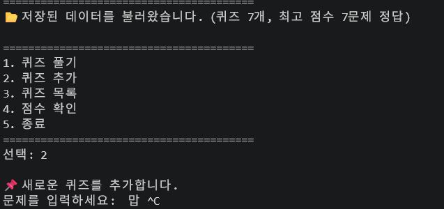
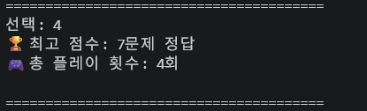

# 🎬 영화 퀴즈 게임 (codyssey_mission1-2)

터미널에서 실행하는 영화 상식 퀴즈 게임입니다.
Python 기본 문법과 클래스로 게임을 구성하고, 퀴즈와 점수 기록을 `state.json` 파일에 저장해 프로그램을 다시 실행해도 데이터가 유지되도록 만들었습니다.
개발 과정은 Git으로 기능 단위 커밋과 브랜치 작업을 하며 기록했습니다.

---

## 1. 프로젝트 개요

| 항목 | 내용 |
| --- | --- |
| 미션 | 올인원 1기 입학 연수 – 컴퓨터에게 명령 내리는 말(파이썬) 처음 배우기 |
| 프로그램 | 터미널(콘솔) 기반 퀴즈 게임 |
| 퀴즈 주제 | 영화 (한국 영화, 할리우드, 마블/DC, 아카데미 등) |
| 개발 언어 | Python 3.10 이상 (표준 라이브러리만 사용) |
| 개발 환경 | Windows + WSL2 (Ubuntu), VS Code |
| 데이터 저장 | 프로젝트 루트의 `state.json` (UTF-8) |

이 프로젝트를 통해 학습한 내용

- 변수, 자료형(int/str/bool/list/dict), 조건문, 반복문, 함수
- 클래스와 객체: `Quiz`(문제 하나), `QuizGame`(게임 전체)으로 역할 분리
- 파일 입출력과 JSON을 이용한 데이터 영속성, `try/except` 예외 처리
- Git 기본 명령어(`init`, `add`, `commit`, `push`, `pull`, `checkout`, `clone`)와 브랜치 병합

---

## 2. 퀴즈 주제 선정 이유

영화는 누구나 한 번쯤 본 작품이 있어 문제를 풀 때 부담이 적고, 감독·배우·명대사처럼 정답이 분명한 문제를 만들기 좋습니다.
또한 평소 영화를 즐겨 보기 때문에 문제를 직접 만들고 힌트를 쓰는 과정 자체가 재미있을 것이라 생각해 주제로 선택했습니다.
'기생충'의 아카데미 수상처럼 한국 영화와 해외 영화를 함께 다뤄 다양한 난이도의 문제를 구성했습니다.

---

## 3. 실행 방법

### 요구 사항

- Python 3.10 이상
- 외부 라이브러리 설치 필요 없음

### 실행

```bash
# 1. 저장소 복제
git clone https://github.com/<GitHub 아이디>/codyssey_mission1-2.git
cd codyssey_mission1-2

# 2. 실행 (WSL/Ubuntu, macOS)
python3 main.py

# Windows PowerShell에서는
python main.py
```

### 종료

- 메뉴에서 `5. 종료`를 선택합니다.
- 실행 중 `Ctrl+C`를 눌러도 데이터를 저장한 뒤 안전하게 종료됩니다.

---

## 4. 기능 목록

### 메뉴

프로그램을 실행하면 아래 메뉴가 출력되고, 번호를 입력해 기능을 선택합니다.

```
========================================
       🎬 영화 퀴즈 게임 🎬
========================================
1. 퀴즈 풀기
2. 퀴즈 추가
3. 퀴즈 목록
4. 점수 확인
5. 종료
========================================
```

### 기능 설명

| 번호 | 기능 | 설명 |
| --- | --- | --- |
| 1 | 퀴즈 풀기 | 저장된 퀴즈를 차례로 출제하고 정답/오답을 바로 알려줍니다. 모든 문제를 풀면 최종 점수를 보여주고, 최고 점수를 넘으면 갱신합니다. |
| 1 | 힌트 보기 | 문제 풀이 중 `0`을 입력하면 해당 문제의 힌트를 볼 수 있습니다. |
| 2 | 퀴즈 추가 | 문제, 선택지 4개, 정답 번호(1~4), 힌트를 입력해 새 퀴즈를 등록하고 파일에 저장합니다. |
| 3 | 퀴즈 목록 | 등록된 퀴즈의 문제 목록을 번호와 함께 보여줍니다. |
| 4 | 점수 확인 | 최고 점수와 총 플레이 횟수를 보여줍니다. 아직 플레이 기록이 없으면 안내 메시지를 출력합니다. |
| 5 | 종료 | 데이터를 저장하고 프로그램을 종료합니다. |

### 입력 및 예외 처리

| 상황 | 처리 방법 |
| --- | --- |
| 입력 앞뒤 공백 (예: ` 1 `) | 공백을 제거한 뒤 처리 |
| 숫자가 아닌 입력 (예: `abc`) | 안내 메시지 출력 후 다시 입력 |
| 범위 밖 숫자 (예: 메뉴 `9`, 정답 `7`) | 안내 메시지 출력 후 다시 입력 |
| 빈 입력 (Enter만 입력) | 안내 메시지 출력 후 다시 입력 |
| `Ctrl+C`, 입력 종료(EOF) | 안내 메시지 출력, 데이터 저장 후 안전하게 종료 |
| 등록된 퀴즈가 없음 | 퀴즈 풀기/목록에서 안내 메시지 출력 |
| `state.json`이 없음 (첫 실행) | `questions.py`의 기본 퀴즈로 시작 |
| `state.json`이 손상됨 | 안내 메시지 출력 후 기본 퀴즈 데이터로 복구 |

---

## 5. 파일 구조

```
codyssey_mission1-2/
├── main.py           # 프로그램 시작점, Quiz / QuizGame 클래스
├── questions.py      # 기본 퀴즈 데이터 (영화 퀴즈 7문제)
├── state.json        # 퀴즈와 점수 기록을 저장하는 데이터 파일 (실행 시 생성/갱신)
├── README.md         # 프로젝트 설명 문서
├── .gitignore        # Git이 추적하지 않을 파일 목록
└── docs/
    └── screenshots/  # 실행 화면 캡처
        ├── menu.png
        ├── play.png
        ├── add_quiz.png
        └── score.png
```

### 클래스 구조

| 클래스 | 역할 | 주요 속성 | 주요 메서드 |
| --- | --- | --- | --- |
| `Quiz` | 퀴즈 한 문제를 표현 | `question`, `options`, `answer`, `hint` | `show()` 문제 출력, `show_hint()` 힌트 출력, `is_correct()` 정답 확인 |
| `QuizGame` | 게임 전체 진행과 데이터 저장 | `quizzes`, `state`, `score` | `run()` 메뉴 실행, `play_quiz()` 문제 풀이, `add_quiz()` 퀴즈 추가, `list_quizzes()` 목록, `print_stats()` 점수 확인, `load_state()` / `save_state()` 파일 입출력 |

---

## 6. 데이터 파일 설명 (`state.json`)

| 항목 | 내용 |
| --- | --- |
| 경로 | 프로젝트 루트 `./state.json` |
| 인코딩 | UTF-8 (한글을 그대로 저장하기 위해 `ensure_ascii=False` 사용) |
| 역할 | 추가한 퀴즈와 최고 점수, 플레이 횟수를 저장해 프로그램을 다시 실행해도 유지 |
| 생성 시점 | 파일이 없으면 기본 퀴즈(`questions.py`)로 시작하고, 퀴즈를 풀거나 추가하면 저장 |

### 스키마

```json
{
  "quizzes": [
    {
      "question": "영화 '기생충'의 감독은 누구인가요?",
      "options": ["박찬욱", "봉준호", "최동훈", "류승완"],
      "answer": 2,
      "hint": "설국열차, 괴물을 만든 감독이에요."
    }
  ],
  "high_score": 7,
  "total_played": 2
}
```

| 키 | 타입 | 설명 |
| --- | --- | --- |
| `quizzes` | list | 퀴즈 목록. 각 항목은 아래 4개 키를 가진 객체 |
| `quizzes[].question` | str | 문제 내용 |
| `quizzes[].options` | list[str] | 선택지 4개 |
| `quizzes[].answer` | int | 정답 번호 (1~4) |
| `quizzes[].hint` | str | 힌트 문구 |
| `high_score` | int | 최고 점수 (맞힌 문제 수) |
| `total_played` | int | 퀴즈를 끝까지 푼 횟수 |

---

## 7. Git 작업 기록

- 기능 단위로 커밋했습니다. (예: `Feat: 퀴즈 풀기 기능 구현`, `Docs: README 작성`)
- 퀴즈 풀기 기능은 `feature/play` 브랜치에서 작업한 뒤 `main`에 병합했습니다.
- 저장소를 다른 폴더에 `clone`해 수정·`push`한 뒤, 원래 폴더에서 `pull`로 변경사항을 가져오는 실습을 했습니다.

```bash
git log --oneline --graph
```

---

## 8. 실행 화면

| 메뉴 | 퀴즈 풀기 |
| --- | --- |
|  |  |

| 퀴즈 추가 | 점수 확인 |
| --- | --- |
|  |  |
